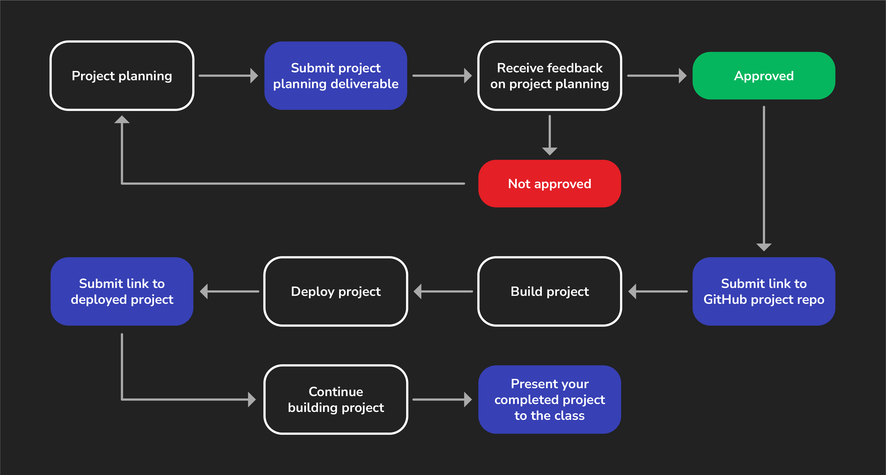

<h1>
  Java Data Structures Library Project
  Project Journey
</h1>

Students typically learn the most while building projects. During this time, you'll be self-directed to plan, build, and complete your project.

You'll need to submit some key deliverables along the way to keep you on track. Finally, you'll present your completed project to the class.

This guide will walk you through the most important components of your project deliverable so that you can be sure you're not missing anything along the way.

## 1. Project info

Before you start planning, review the [project requirements](../requirements-and-guidance/README.md) to understand what features you must implement in your project. The **Guidance** section in that document also includes helpful tips to get started.

## 2. Create a GitHub repo

Create the public GitHub repo that you'll use for the project. See the [Project Deliverables](../deliverables/README.md) for more details.

## 3. Build the project

The fun part! Start building your project! The printable [project requirements PDF](../requirements-and-guidance/assets/project-requirements.pdf) may be useful for checking items off as you build your project.

## 4. Deploy the work you have so far

Deploy your project to the internet following the included deployment guide and submit a URL for your deployed app. For more details, see the [Project Deliverables](../deliverables/README.md).

Continue working on your project until presentation day.

## 5. Submit the URL for your completed project

Submit the URL for your the GitHub repo containing your project's JAR file. For more details, See the [Deployed App Deliverable](../deployed-app-deliverable/README.md).
